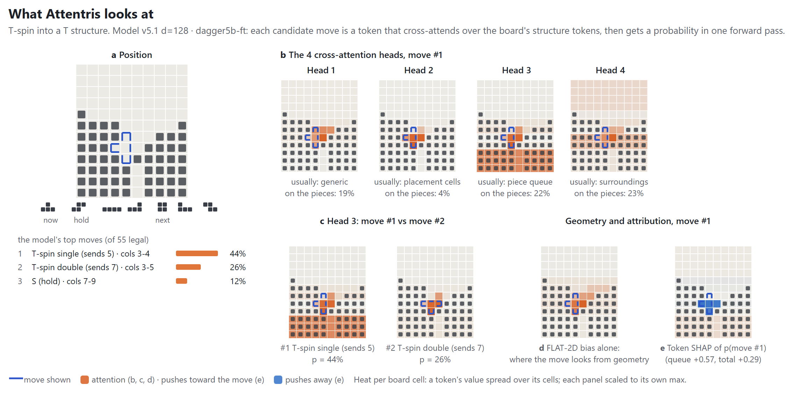
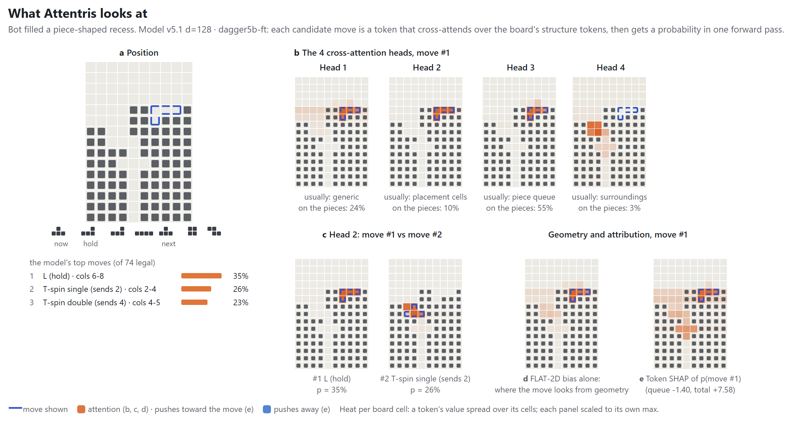
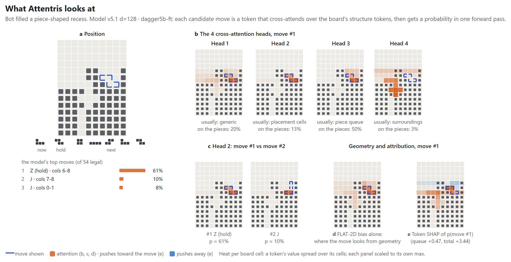
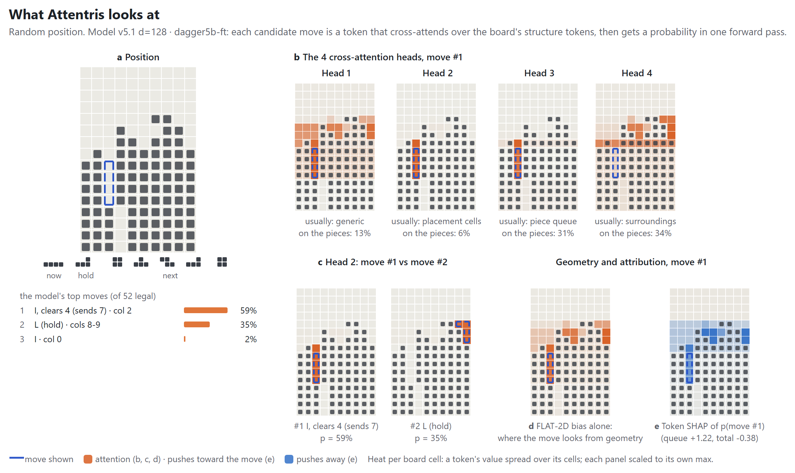
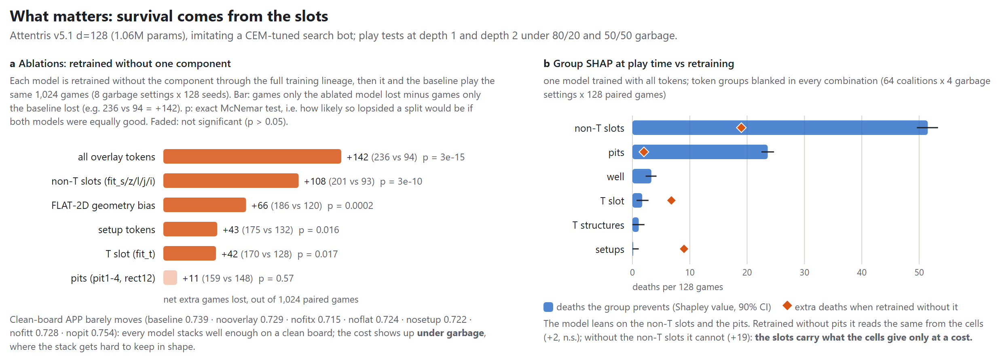

# Attentris

**A transformer that plays modern (7-bag) Tetris and shows its reasoning.** It reads the board as Tetris structures (wells, slots, T-spin setups) instead of raw cells. Every legal move is a token, so one forward pass scores them all. For any move you can see what the model looked at, and test which structures it actually needs.

A Tetris bot project that is half fun, half research. It has two parts:

- **Attentris (PyTorch).** A small transformer (1.06M parameters) that learns to play from the search bot. It sees the board as **rule-based structure tokens**, and **every legal move is a token** that attends over the board. That makes it possible to look at what the model attends to for each move, and to measure which board structures it actually relies on.
- **A search bot (Rust).** A linear board evaluator tuned with the cross-entropy method (CEM), driving a beam search. It is the teacher, and at matched compute it beats [Cold Clear 2](https://github.com/MinusKelvin/cold-clear-2) in our versus harness.

Visuallising Attention and SHAP attribution of the played moves show that identifying *harmonious* placement leads to strong play (optimised for VS score). 

---

## The teacher: CEM-tuned search bots

Classic Tetris (full random, no-tspin, only survival) was solved using CEM (Cross Entropy Method). I tried extending the same method but instead on modern 7-bag tetris. (Note CMS-ES is also a good algorithm but emprically CEM converges faster). All training data comes from search bots. Each is a linear value function V(s) over hand-made board features (holes, bumpiness, row transitions, wells, T-slot and B2B features, …), tuned with CEM and searched with a beam (depth 6, width 64):

| Bot | Tuned for | |
|---|---|---|
| **CEM** (`bot/weights/normal.txt`) | attack on clean boards | APP ~1.22 |
| **CEM-survival** (`bot/results/survive/survive.txt`) | versus score under 50/50 garbage | survives where CEM dies |

Against **Cold Clear 2**, run unmodified over TBP with one thread, guideline SRS and no 180° rotation, 64 matches each:

| Setting | Result |
|---|---|
| Fixed time per move | CEM-survival beats CC2 **56–8** |
| Realtime, both thinking ~5 ms per move (~180–200 pieces per second) | CEM-survival at depth 5, beam 12 beats CC2 **45–19**; at depth 4, beam 16, **39–25** |
| The same, with both forced to the same speed (6 ms per piece) | depth 5, beam 12 still wins **45–19**, so its edge is move quality; depth 4, beam 16 drops to 35–29, so most of its edge was speed |

CC2's weights are published, but not how they were tuned. They were presumably tuned for versus play. We play CC2 under our garbage settings.

Details: `attentris/NOTES.md`, "Versus" and the realtime sections after it.

## Attentris: the model

```
 board ──► rule tokenizer ──► structure tokens, each with a cell mask and a bounding box
                               (sky, wells, play rows, pits, slots fit_S/Z/L/J/I/T,
                                T structures, setups; plus current / hold / next 5 pieces)
                                        │
                                        ▼
              ┌──── FLAT-2D ────►  4 self-attention layers  (board token ↔ board token)
              │     bias A                  │
 pair geometry│                             ▼  board tokens, contextualised
 of two tokens│                             │
 (9 features) │                             ▼
              └──── FLAT-2D ────►  cross-attention  ◄── every legal move, one token each
                    bias B         (move → board tokens)      (its 4 cells, piece, spin, lines, attack)
                                            │
                                            ▼
                                  per move: policy logit + value (Qs)

 attention score(q, k) = Q·K / √d  +  FLAT-2D(q, k)      for each of the 4 heads
```

- **Board tokens.** A rule-based tokenizer cuts the board into Tetris concepts. These are the clean well, the play rows, pits, the open or covered places where each piece fits (`fit_X`), T-spin structures (TSD, STSD, imperial cross, …), and setups one piece away. The piece queue gets tokens too. Each token is pooled from the cells under its mask.
- **FLAT-2D.** A learned geometry term added to every attention score, inside the softmax, in both attention stages:
  - **The input.** For each pair of tokens there are 9 features: the 4 row offsets and 4 column offsets between the two bounding boxes' edges, plus how many cells the two masks share.
  - **The output.** A small MLP (9 → 32 → 4) turns them into one score per head.
  - **Bias A** is computed once and shared by all 4 self-attention layers.
  - **Bias B** has its own MLP and relates a move's 4 cells to each board token, e.g. "this move fills that slot", or "it sits two rows above that pit".
  - Piece tokens have no position, so they get a learned constant per head instead.
  - Content (Q·K) says what a token means; FLAT-2D says where it is relative to the query.
- **Moves as tokens.** The Rust move generator lists every legal placement. Each one becomes a token that cross-attends over the board tokens and gets a probability. One forward pass scores all moves, in about 4 ms on one CPU core.
- **Training.** Distilled from the search bots on 1.09M labelled positions. Training on pure teacher games wasn't enough because the teacher does not get into poor positions so bad positions were initially out-of-distribution. The solution was to use 3 DAgger rounds on positions where the model itself got into trouble, labelled by CEM-survival. Three style tags (`normal`, `gate4`, `danger`) select the teacher's style at play time.

### Modelling Tetris - Board Tokens + Overlays
Every game state is the 20x10 play area + current piece + hold + preview pieces. The play area is partitioned into the *sky*, *well*, and individual *play rows*. Additionally there are overlays which are *Tspin hangs*, *setups*, *structures*, *fit-x* . How well modelled is the tetris problem is answered by Ablations and SHAP.

### Play Strength
Plays 500-piece games at depth 1 (no search), d = 128 (dagger5b-ft):

| | APP, no garbage | Deaths /64, 80/20 garbage | Deaths /64, 50/50 garbage |
|---|---|---|---|
| Attentris, `normal` style | 0.74 | 18 | 44 |
| Attentris, `danger` style | | 4 | 25 |
| CEM teacher (depth 6, beam 64) | 1.22 | 18 | 33 |

Garbage: a batch of 3–4 rows every 10 pieces. "80/20" means 20% of batches are cheese, "50/50" half of them.

## Attention Map: What Attentris looks at

Each candidate move's cross-attention row is a map of what the model read for that move. The four heads take different roles: head 1 is generic, head 2 sits on the cells the piece will fill, head 3 often reads the piece queue, and head 4 looks around the placement. FLAT-2D (panel d) is where a move would look from geometry alone. Token SHAP (panel e) is which tokens actually changed the move's probability. Attention shows where information flows from; SHAP is the check on whether it mattered.



**Two T-spins, and the model picks the "vertical" one.** The T can go in as a T-spin double or as a vertical T-spin single. The model prefers the single (44% vs 26%). For the single, head 3 puts 59% of its attention on the clean **well** (24% for the double). SHAP agrees: the well (+1.77) and the **I piece next in the queue** (+0.90) push toward the single, while the TSD-structure token argues for the double (−1.96). Our reading: the single keeps the well open for the incoming I, so the T-spin is followed by a quad.



**Fit first, keep the T for its slot.** With a T in hand and an L in hold, the model takes the L into an L-shaped recess (35%) over two T-spins (26%, 23%). For the L, head 2 puts 73% on the `fit_l` slot. For the T-spin single it looks at a Z slot instead. SHAP shows why the T waits: the **imperial cross** token pushes toward the L (+1.55) and against spending the T now (−0.97).

<details>
<summary>Two more positions</summary>



**Fill the slot, keep the bigger structure in mind.** The Z from hold fills a Z slot (61%): head 2 puts 55% on `fit_z`, while head 4 keeps 35% on the imperial cross that the move leaves intact (SHAP +0.42).



**When the tokens don't decide.** A quad (59%) against an L into its slot (35%). For each move, head 2 lights up its own target. SHAP adds the twist: the structure tokens raise the L's log-probability by +3.0, but slightly *lower* the quad's. The model is already sure of the quad from the cells and the I in hand, so the structure tokens explain the L, not the quad.

</details>

The interactive version of these pages (66 positions, every head, geometry vs content, SHAP) is built by `attentris/attn_viz.py` and `shap_page.py`. The README figures come from `attentris/readme_figs.py`.

## What matters? survival comes from the slots



There are two complementary ways to ask which parts matter:

- **Ablation (a).** Retrain without one component. Then the ablated model and the baseline play the same 1,024 games (8 garbage settings × 128 seeds). Pairs where both survive or both die say nothing, so the test looks only at the games just one of them lost. Without the overlay tokens, the ablated model alone lost 236 games and the baseline alone lost 94: the bar shows the difference, +142. The p-value is an exact McNemar test: how likely a split that lopsided would be if the two models were equally good. Faded bars are not significant (p > 0.05). This asks whether the model can do without the component.
- **Group SHAP (b).** Take the one trained model and blank token groups at play time, in all 64 combinations. Fair shares of the deaths prevented follow from that. This asks whether the model relies on the group.

What they say together:

- **Every ablated model still stacks well enough on a clean board.** The costs show up **under garbage**, where keeping the stack in shape gets hard. The model learns to use other components more when any other component is ablated- Except for fix-X.
- **The non-T slots (`fit_S/Z/L/J/I`) are the strongest result.** The model relies on them (−52 deaths per 128 games by SHAP), and retrained without them it is worse (+19). It cannot recover them cheaply from the raw cells.
- **T-specific tokens matter little for survival.** The T slot, T structures and setups contribute about 0 deaths by SHAP and small amounts by ablation. That doesn't mean the model ignores T-spins: on 894 T-spin moves, the T structure is the most-attended token 49% of the time (7% by chance), and the positions above show T reasoning. It means it can find them without the hand-made T tokens.

### Tetris is a Short Credit Horizon game

Tetris has a **short credit horizon**. With a 7-bag and 5 previews, most of a move's value shows up within a bag or two. A clean stack keeps renewing its own chances, and there are no long-term sacrifices like in chess. So a good evaluator plus a short lookahead lands close to the long-horizon optimum: **a well-kept stack keeps producing attack chances, so greedy-plus-lookahead on a good evaluator is near-optimal**. The skill is in harmonious placement, putting each piece where it fits. The slot results above point the same way. This is an interpretation, not something we tested directly.

## Caveats

- **The search bot is still stronger than the network.** At depth 1 Attentris reaches 0.74 APP against the teacher's 1.22. With its own search (depth 6, beam 8) it gets 1.04 APP and survives garbage better than the teacher (normal style 50/50: 20 deaths vs 33), but at ~290 ms per move against ~30 ms. There are two reasons:
  - **Imitation ceiling.** The network learns to imitate a depth-6 search with a one-pass policy, so it can hardly beat its teacher.
  - **Evaluation cost.** A linear V(s) costs about a microsecond, a transformer forward pass about a millisecond. In the same time the search bot evaluates thousands of times more positions. A cheap evaluator searched deeply beats an expensive one searched shallowly, at least in a game whose value is this easy to approximate.
- **What the model learned is partly what its teacher knew.** The teacher's features and the tokens both encode Tetris knowledge (wells, slots, T structures). "What matters" here means what matters to imitate a survival-tuned search bot. That is close to, but not the same as, what matters in Tetris.
- **Survival and attack are coupled.** Every piece placed is pressure, so good stacking is always needed, even without garbage. Dying forfeits all future attack, so measures of attack are never fully separate from survival. Per-move SHAP (above) is the most local view we have.
- **Attention is not an explanation by itself.** It shows where information was routed from, not what decided. That's why each attention figure comes with SHAP, and the global claims rest on ablations and group SHAP, not on attention maps.
- **One training run per ablation.** The ablation p-values cover game-to-game noise, not training-seed noise.
- **Rules.** Guideline SRS for 90° rotations plus an SRS+ table for 180°, on 40 rows with 20 visible. Garbage arrives immediately in single-player tests. TETR.IO's kick tables differ slightly, mainly for the I piece.

## Related

*Classic* Tetris here means the original single-player game, scored by lines cleared: usually no hold, a one-piece preview, and no T-spins, back-to-back or garbage. *Modern* Tetris means guideline versus play as in TETR.IO: SRS rotation, hold, a 5-piece preview, T-spins, back-to-back, combos and garbage.

- **Tetris in machine learning** (classic). Algorta & Şimşek, [*The Game of Tetris in Machine Learning*](https://arxiv.org/abs/1905.01652) (2019), is a history of the field: hand-made controllers, genetic algorithms, reinforcement learning, approximate dynamic programming.
- **CEM-tuned evaluators** (classic). Szita & Lőrincz, [*Learning Tetris using the noisy cross-entropy method*](https://cs.utexas.edu/~shivaram/readings/b2hd-SzitaLorincz2006.html) (Neural Computation, 2006): a linear evaluator over hand-made features, tuned with CEM, beat the RL and dynamic-programming methods that used the same features. 
- **Deep RL** (classic). Most public attempts are student projects. [nuno-faria/tetris-ai](https://github.com/nuno-faria/tetris-ai) is the popular reference: deep Q-learning on 4 board features (lines, holes, bumpiness, height), choosing among final placements. A recurring finding is that learning from raw cells and game reward alone rarely gets far.
- **Search bots** (modern). [Cold Clear 2](https://github.com/MinusKelvin/cold-clear-2) is a search bot (anytime best-first search over a hand-tuned evaluator) and the baseline we play against.
- **A transformer** (modern). [QTris](https://github.com/m-sher/QTris), a personal project, is a vision transformer for modern versus Tetris. A small CNN cuts the board into patches, and the legal placements are ranked by cross-attention. It is trained by behaviour cloning from a beam-search oracle and DAgger, then refined with AlphaZero-style MCTS self-play. It publishes no weights and no strength numbers. It is the closest project to Attentris that I know of.
- **Transformers for chess** (the inspiration). Monroe & Chalmers, [*Mastering Chess with a Transformer Model*](https://arxiv.org/abs/2409.12272) (2024), the Chessformer behind Leela Chess Zero's transformer nets, showed that the position representation and attention biases matter more than size. Its follow-up, [*Chessformer: A Unified Architecture for Chess Modeling*](https://arxiv.org/abs/2605.19091) (ICLR 2026), introduces the Geometric Attention Bias (GAB). Attentris started as an attempt to carry these ideas to Tetris: structure tokens instead of squares, and FLAT-2D as a geometric bias for tokens that have irregular shapes instead of fixed squares.

## Repository

| Path | What |
|---|---|
| `bot/` | Rust: rules, move generator, CEM tuner, beam search, dataset / labelling tools, versus harness (`bot/tools/versus.py`), Cold Clear 2 driver |
| `attentris/` | Python: tokenizer, model, training, play tests, DAgger, attention / SHAP pages, ablation and SHAP scripts |
| `attentris/NOTES.md` | The lab notebook: architecture, benchmark protocol, every result, open plans |
| `attentris/DESIGN.md` | Tokenizer and model specification |
| `core/`, `view/`, `*.tscn` | Godot game: rules, board, replay viewer (`replay.tscn`) |
| `SETUP.md` | Machine setup (Windows / Ubuntu) and data sync |

Models and datasets are not in git (~11 GB). `attentris/data_bundle.py` packs and unpacks them. See `SETUP.md`.

### Quick start

```sh
# the search bot
cargo build --release --manifest-path bot/Cargo.toml
bot/target/release/bot play --weights bot/weights/normal.txt --games 8 --pieces 500

# Attentris play test (needs a checkpoint in attentris/data/)
python attentris/play.py --model attentris/data/model_v51_d128_dagger5b_ft.pt --depth 1 --games 64

# watch a bot game in the Godot viewer
godot --path . res://replay.tscn -- --replay=res://data/bot/<file>.jsonl
```
